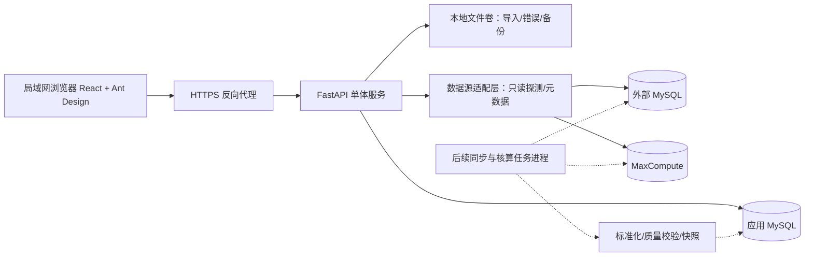

# 商务数据分析网站 · 系统设计 V1.0

日期：2026-10-26。依据：项目内《BD奖金计算与查询系统_最终需求文档_V1.0.md》与《参考UI.html》。本设计补充数据库与数仓接入、多表扩展和可部署基础版，不将需求中的待确认项视为已确认。

**2026-10-26 用户追加变更（优先于下文原始基础版边界）**：新增8位中文姓名BD账号、“梁梓珊”超级管理员角色及用户自行修改密码。业务总览参考表现在允许BD访问，超级管理员通过持久化开关决定BD仅本人或全部账单（含无归属）；默认仅本人，服务端在所有查询、选项和统计前实施权限，只有超级管理员可修改。该开关不改变奖金演示模块及其他管理接口权限。增加 `system_settings` 表和策略版本检查、操作审计；前端每15秒检查策略变化。原文关于“尚未实现改密”“参考表仅管理员”等描述为历史交付范围，以此变更为准。

## 1. 产品定位与交付范围

网站定位为商务运营统一工作台，第一期以奖金查询与核算为主，数据接入层为后续业绩、回款、人效等分析服务。部署于局域网服务器，浏览器访问；MaxCompute 连接需要服务器能够访问对应云地域网络，完全断网环境不能实时连接云数仓。

本次代码交付的是可运行基础版，不等于全部 V1.0 业务需求已验收。界面采用 React、TypeScript、Ant Design，5 套配色按账号保存。生产脚本和图标打包到本地，不调用外部 CDN。

| 能力 | 基础版实现 | 生产迭代要求 |
| --- | --- | --- |
| 登录、停用、会话注销 | 已实现 | 后续补充密码自助修改、重置、SSO 及复杂角色 |
| 个人数据隔离 | 列表、详情、趋势与导出统一过滤本人 | 团队范围按业务确认扩展 |
| 账号角色 | 管理员、个人 BD | 运营、负责人、系统运维职责分离 |
| 我的奖金与总览 | 虚构快照、期间与状态筛选、明细、导出 CSV | 连接已确认的真实业务模型与计算结果 |
| 5 套主题 | 已实现服务端按用户保存 | 跨浏览器验收与持续无障碍验证 |
| MySQL / MaxCompute | 配置持久化、真实连接探测、受限表结构读取 | 在实际网络及最小权限账号下联调 |
| 数据表接入 | 数据集、主键、人员字段、水位、分区与映射草稿 | 校验映射、同步执行器、调度、对账 |
| Excel 导入 | 展示明确的待开放流程 | 收到样表后实现预览、校验、幂等与批次提交 |
| 规则与核算 | 待确认口径清单；后端拒绝真实试算 | 规则表单、受控公式引擎及业务样例测试 |
| 发放、调整、结算 | 展示演示余额与状态 | 多次发放、事务锁、确认锁定与冲正 |
| 审计与备份 | 基础操作日志、部署与备份方案 | 导入/调整/结算前后值审计与恢复演练 |

## 2. 页面与视觉

默认布局为深色左侧导航、白色顶栏、蓝灰内容底色，参考 UI 的信息分区与克制配色，避免长报告式滚动。金额统一为人民币元，右对齐、保留两位；演示金额不构成计奖参数。

| 导航 | 核心信息与操作 | 数据权限 |
| --- | --- | --- |
| 业务总览 | 应计、已发、待发、季度累计、趋势、奖金明细 | 当前账号范围 |
| 我的奖金 | 本人指标、明细、来源与发放余额 | 强制本人；管理员没有本人业务时为空 |
| 奖金核算 | 准备→异常核对→试算→结算→发放 | 目前管理员；以后按能力授权 |
| 数据导入 | 类型→文件→字段→校验→确认→结果 | 后续独立上传能力 |
| 规则配置 | 基数、阶梯、分摊、退款、精度、版本 | 以后独立规则管理能力 |
| 异常处理 | 原因、来源、修复建议与核对入口 | 授权订单范围 |
| 数据接入 | 数据源、凭证引用、表结构、数据集及映射 | 管理员 |
| 系统设置 | 账号、停用、操作日志 | 管理员 |
| 头像/外观 | 经典蓝、清新绿、雅致紫、湖水青、暖琥珀 | 个人偏好 |

前端隐藏菜单只改善体验，权限控制必须在 API 和查询构建层执行。共享订单目前不暴露合作人姓名及他人金额，待业务确认再开放字段。

## 3. 架构与选型决策

实线为基础版运行路径；虚线为后续任务执行器。开发可使用 SQLite 演示，生产使用 MySQL；SQLite 与 MySQL 不能直接复制数据库文件互换。

### ADR-001：模块化单体

选择 React + FastAPI + MySQL，前端构建产物由同源后端服务提供。比纯静态原型能落实后端权限与连接；比微服务减少服务器、网络和运维成本。代价是以后长任务须拆成独立 worker。当前不引入 Redis、消息队列、Kubernetes，出现真实并发和调度需求后再添加。

### ADR-002：MaxCompute 经 Python 适配器接入

采用 PyODPS 进行项目鉴权和元数据读取；后续批量任务按分区或 Tunnel 拉取。MySQL 使用 PyMySQL，应用持久化使用 SQLAlchemy。避免浏览器直连或将 AccessKey 发到前端；Python 更适合 Excel 和后续数仓批处理。代价为维护 Python 与前端两套构建环境，Docker 将其封装成单个应用镜像。

### ADR-003：源库与应用库隔离

`DATABASE_URL` 仅用于本站账号、配置、结果和审计；网站“数据源连接”指外部业务数据源。即使外部源同为 MySQL，也应使用独立只读账号。网站不向外部源库写业务数据，异常与人工修正在应用库记录覆盖层，不反写数仓。

### ADR-004：先同步到标准模型，再提供业务查询

生产模式采用“同步/校验/快照→标准模型→权限查询”，避免每个页面直接扫描 MaxCompute。优势为查询稳定、权限集中、便于历史重算与对账；代价为数据存在延迟与存储成本。页面必须显示最后成功同步时间和失败状态，查询时间不能冒充数据更新时间。

### ADR-005：配置驱动，禁止任意 SQL 暴露给 BD

接入层保存来源配置与映射，业务层查询标准模型。自定义 SQL 仅在后续受控管理员维护的模板库中评估，绑定参数、只读账号、超时与扫描量预算均为前置条件；不开放任意查询编辑器。

## 4. 数据接入契约

### 4.1 数据源连接

公共字段：`id / name / kind / description / credential_ref`；MySQL：`host / port / database`；MaxCompute：`endpoint / project`。后续增加状态、最近测试时间、网络区域、责任人、连接超时、TLS 与运行环境。

基础版凭证引用如 `BD_SOURCE_ORDER_MYSQL`，它是服务器环境变量名称，对应值为 JSON。MySQL 值为 `{"username":"只读账号","password":"实际密码"}`；MaxCompute 值为 `{"access_id":"实际ID","access_key":"实际密钥"}`。前端和应用配置表均不保存凭证内容。后续可把引用解析切换为云密钥管理服务；建议优先使用 RAM 角色/STS，基础版尚未实现自动刷新临时凭证。

服务器配置 `BD_ALLOWED_SOURCE_HOSTS`，只有白名单目标才允许连接。源库账号实际权限应由数据库或 RAM 控制为只读；应用不宣称仅靠按钮就能限制云账号所有权限。MySQL 凭证 JSON 可配置 PyMySQL `ssl` 参数（容器内 CA 文件路径等），TLS 验证须在实际环境验证。MaxCompute Endpoint 只接受 HTTPS，实际地域与网络以控制台为准，不猜测。

### 4.2 数据集与表映射

每张源表建立独立数据集；同一连接支持多数据集，业务页面无需随表数增加而修改导航。

| 字段 | 含义 | 基础版状态 |
| --- | --- | --- |
| `source_id` | 所属数据源 | 已实现存在性校验 |
| `table_name` | 源表名 | 已实现标识符校验 |
| `target` | orders / receipts / allocations / payments / custom | 已实现 |
| `primary_key` | 源稳定主键 | 单字段草稿；复合键后续扩展数组 |
| `owner_field` | 源人员编号字段 | 必填；后续关联人员字典 |
| `mapping` | 标准字段→源字段 | 已保存 JSON，只允许标识符 |
| `watermark` | 增量更新时间或流水字段 | 已预留，尚未执行同步 |
| `partition` | MaxCompute 分区约定 | 文字草稿，不作为 SQL 执行 |

生产扩展字段：`schema_name / key_fields[] / schema_version / identity_mapping_id / deletion_policy / partition_template / lookback_window / schedule / timezone / sync_mode / field_types / enum_mapping / date_format / amount_scale / conflict_policy / retention_days`。

例：订单模型可把 `order_no→order_id`、`owner_id→bd_id`、`contract_amount→contract_amt`、`updated_at→modify_time`，真实字段名仍须根据表结构核验。人员字段关联到内部稳定 `user_id`，不能靠姓名猜测归属。订单、回款、共享和发放先各自建模，再按稳定业务键关联。

### 4.3 后续同步执行流程

1. 读取已批准映射版本，取得分区或 `(watermark, primary_key)` 游标；时间采用固定时区，记录来源时区。
2. 按页或分区写 staging，保存源主键、来源时间、同步批次、内容哈希、原始快照。
3. 校验必填、类型、金额、归属、引用键、重复及分摊比例；无权限或无法归属记录进入隔离区。
4. 以 `(dataset_id, source_primary_key)` 唯一键幂等合并；重复任务不能重复计算或产生第二笔回款。
5. 同步数据与游标成功状态同一事务提交；失败保留旧游标，重新运行可恢复。
6. 水位重叠回看与哈希去重应处理延迟更新；删除通过软删标志或周期对账识别；跨分区修改需回扫。
7. 比较笔数与金额，异常超过阈值时阻止进入可结算区；展示最近成功时间、异常数和数据延迟。
8. 新字段或类型变化触发 schema diff，保留旧映射可用版本；未经审批不能自动改奖金口径。

MaxCompute 不作为事务业务库；按明确分区读取，限制扫描量、任务并发、行数与运行时间。执行成本须结合真实数据规模评估。基础版仅探测元数据，不执行全量查询或产生 SQL 计算任务。

### 4.4 扩展分析模块

预留标准维度 `person / department / customer / service / channel / period` 与事实模型 `orders / receipts / allocations / bonus_results / payments`。后续增加营收、回款周期、转化、人均产出时，登记指标定义、分子分母、时间口径、来源数据集、负责人、版本与权限策略。新增表不会自动形成可信指标，必须确认业务语义。

## 5. 数据模型

基础版实际表：`users / sessions / bonus_demo_records / data_sources / datasets / audit_logs`。源配置与数据集草稿暂存 JSON，后续结构化与版本迁移。`bonus_demo_records` 只供演示；生产空库无虚构奖金记录。

下表为完整业务目标模型，尚非全部已实现表：

| 模型 | 关键字段 / 约束 |
| --- | --- |
| users、roles、permissions | 稳定人员ID、账号状态；能力与数据范围分离 |
| user_scopes、departments | user、department、有效起止日期、是否允许历史数据 |
| person_source_links | 数据集、源人员编号、内部人员ID；唯一映射，保留离职记录 |
| source_connections | 类型、非敏感配置、凭证引用、环境、状态与测试时间 |
| dataset_versions | 来源、模型、映射、主键、增量、分区、版本与批准人 |
| sync_runs、sync_errors | 批次、游标、版本、笔数、金额、错误定位、重试与幂等键 |
| import_batches、import_rows | 文件哈希、模板版本、状态、原始文件、工作表/行号 |
| orders、order_ownerships | 来源键、订单号、客户、金额、渠道、归属及历史有效期 |
| receipts、refunds | 回款/退款流水键、订单号、日期、币种、金额 |
| allocations | 订单、参与人、比例/金额、依据、版本；合计校验 |
| rule_versions、rule_tiers | 适用范围、生效日期、阶梯方式、基数、表达式、舍入、审批 |
| calculation_runs、calculation_items | 人员、期间、输入快照、来源批次、规则版本、轨迹、差异 |
| settlements、settlement_items | 状态、版本、确认人、锁定时间；计算结果不能直接覆写 |
| adjustments | 原结果、调整金额、原因、申请/审核人、审计链 |
| payment_records | 结算项、来源发放流水号、预计/实际日期、金额、冲正引用 |
| audit_logs | 操作者、动作、对象、前后值摘要、请求ID、时间；不记录密钥 |

货币使用 Decimal / MySQL DECIMAL(18,2)，比例用定点数；后续根据真实币种精度升级。奖金汇总不得依赖浮点数；当前前端对演示两位小数按分汇总用于展示，最终权威金额应由后端生产聚合接口返回字符串。时间统一存 UTC，业务归属期按确认时区计算。

## 6. 权限与认证

基础版独立账号 + scrypt 密码哈希 + HttpOnly/SameSite 严格会话 Cookie；会话有效 8 小时，数据库只存 token 哈希，注销立即删除，账号停用后下一次请求即拒绝。写请求要求自定义请求头且不开放跨域 CORS。公网或跨网络正式访问必须配置 HTTPS，并开启 `COOKIE_SECURE=true`。

生产角色建议从管理员细分为业务运营、规则维护、结算确认、负责人、系统运维。系统运维不应自动获得所有财务明细；基础版管理员当前拥有全局管理权限，须在正式财务上线前分权。

查询原则：先在 SQL 中限制人员范围，再做列表、详情、导出、指标与图表聚合；禁止先读全量再在浏览器过滤。BD 请求不存在或他人明细返回相同 404，避免通过编号探测。权限不能由前端传入 owner_id 决定；团队范围从服务端授权表读取。基础版无团队角色、共享合作人明细或开放认领。

基础版限流为单进程内存登录频次限制；多实例时升级共享限流存储或网关。源连接与元数据为管理员能力，配置真实目标白名单、只读账号及超时；不回传原始 SDK 错误，以免包含密钥和内部拓扑。

## 7. 奖金与结算规则设计

真实口径待确认：基数含税与否、计奖日期、自然季度、全额/分段阶梯、跨档追补、分摊顺序、退款归期、优先级、舍入、封顶保底。任何示例金额与比例均不可作为默认参数。

规则引擎后续采用受控表达式 AST 白名单，允许已登记字段、四则运算、条件和查表；禁止 eval、动态函数和文件/网络访问；对缺失、除零、循环引用和不适用规则产生异常，不默认为零吞掉问题。

计算状态：`prepared → validated → previewed → reconciled → confirmed → locked`。每次试算冻结来源版本和规则版本，记录对比基线；确认前重新验证源数据版本。变更必须先展示影响人员、期间和差额。已锁结果通过新调整记录或授权解锁处理；结算项唯一键和幂等请求键共同防止重复确认。

发放为多条流水：`unpaid → partial → paid`，不能用一个日期字段覆盖多次发放。支付归属期与奖金归属期分开统计。以流水号幂等，超发及负数处理由确认规则决定；登记与余额核验在事务中锁定结算项。系统只管理发放记录，不自动执行银行付款。

## 8. API 设计

基础版均为同源 `/api`，金额以十进制字符串返回。配置接口验证输入结构，敏感凭证从不返回。

| 接口 | 实现与权限 |
| --- | --- |
| GET health | 运行状态及演示标记，不回传数据库连接信息 |
| POST login / logout，GET me | 登录、注销、本人身份 |
| PUT me/theme | 本人主题保存，枚举限定 5 套 |
| GET bonuses | 已实现人员范围；`personal=true` 强制本人，支持期间过滤 |
| GET bonuses/{id} | 对象归属权限 |
| GET bonuses/export | 与列表相同权限；CSV，导出单元格公式注入处理 |
| GET/POST sources | 管理员查看/保存连接 |
| POST sources/{id}/test | 白名单与凭证校验后真实只读探测 |
| GET sources/{id}/metadata | MySQL 最多 2000 列；MaxCompute 最多 20 表 |
| GET/POST datasets | 管理员保存数据表映射草稿 |
| GET/POST users，PUT users/{id}/active | 管理员创建和停用账号 |
| GET audit | 管理员最近100条日志 |
| POST settlements/preview | 基础版固定409，说明未确认规则，拒绝生成真实奖金 |

下一阶段增加分页/排序/服务端搜索、聚合看板 API、后台任务状态、导入预览提交、规则版本、结算/调整/发放 API。接口幂等键、乐观锁版本和请求ID与任务ID随业务工作流一起实现。演示查询返回少量全部授权记录，不能据此承诺大数据性能。

## 9. 部署与运行

提供 Dockerfile 与 Compose：MySQL 8.4 应用库 + 前后端应用容器，同源端口 8080（可改），持久卷独立；只映射应用端口，MySQL 不默认暴露宿主端口。正式模式默认不生成演示账号和订单，首次管理员密码从服务器环境读取。演示与正式必须使用独立数据库，启动时发现已知演示数据会拒绝正式运行。

基础版用 SQLAlchemy create_all 创建初始表；正式业务迭代前引入 Alembic 版本迁移，禁止依赖 create_all 修改已有表。升级流程先备份、验证目标版本、迁移、启动、健康检查；回滚依赖可兼容迁移或恢复备份，不能只回滚镜像假定数据库可逆。

备份覆盖数据库、文件卷、配置及单独保管的凭证；恢复到隔离数据库验证账号、配置、笔数与金额。初步建议每日备份、上线前额外备份，频次和保留期由业务批准；不提前承诺 RPO/RTO。日志不记录密码，备份权限与生产数据相同。

性能目标待确认人数、并发、订单和文件量后制定。重点观测 API 延迟、错误率、数据库连接池、任务耗时、数仓扫描量、最后成功水位、对账差额。大查询与导出改为后台任务，避免堵塞交互线程。

## 10. 失败场景

| 场景 | 行为与恢复 |
| --- | --- |
| 外部源不可达、凭证失效 | 返回可操作错误，不伪造成功；保留上次成功快照；后续退避重试 |
| 应用数据库不可用 | 健康检查失败；禁止继续提交；恢复库后重启 |
| 源字段漂移 | 暂停受影响数据集，不静默转换或影响已锁结果 |
| 重复导入/重复任务 | 生产实现唯一键 + 事务 + 幂等键，不能只靠前端禁用按钮 |
| 人工修正后再次同步 | 保存覆盖层及原因；依据批准的优先级提示冲突 |
| 多人确认同一结算 | 生产用行锁/版本检查；只允许一个确认事务成功 |
| 主题保存失败 | 显示错误，保持服务端已保存主题，不修改业务筛选 |
| 演示环境切换正式 | 拒绝包含已知演示记录的库，要求独立空库初始化 |

## 11. 验收与下一步输入

基础版技术验收：类型检查与生产构建；登录/注销/停用；两个BD之间列表、详情、图表数据源和导出隔离；管理员接口禁止BD；主题按账号保存；数据源与映射格式校验及重复拒绝；无凭证/白名单不连接；未确认规则拒绝试算。

真实业务上线前必须完成：真实 MySQL/MaxCompute 联调、Excel 样表对账、公式边界与退款/跨期/共享样例、结算锁定与重复提交、发放对账、五主题浏览器验收、局域网多机访问、备份恢复演练、实际规模性能与依赖安全审查。本次没有真实源账号、服务器或样表，不能宣称这些已通过。

后续请提供：服务器系统与可用端口；应用 MySQL；源 MySQL 只读账号及主机；MaxCompute 地域、项目、Endpoint 与授权方式；源表名、结构、主键、人员映射和更新字段；梓珊发放模板及订单回款样表；9项计奖口径和权限确认。密码与密钥直接在服务器配置，不粘贴到需求文档或源码。

## 12. 技术依据

- [Ant Design 主题配置](https://ant.design/docs/react/customize-theme/)：ConfigProvider 与 Token。
- [PyODPS 官方 API 源码文档](https://pyodps.readthedocs.io/en/latest/_modules/odps/core.html)：ODPS 项目、Endpoint 及认证参数。
- [SQLAlchemy MySQL 方言](https://docs.sqlalchemy.org/en/latest/dialects/mysql.html)：应用 MySQL 驱动及连接配置。

依赖直接版本在 package.json、pnpm-lock.yaml 与 backend/requirements.txt 固定；不得在无回归验证时自动升级主版本。
